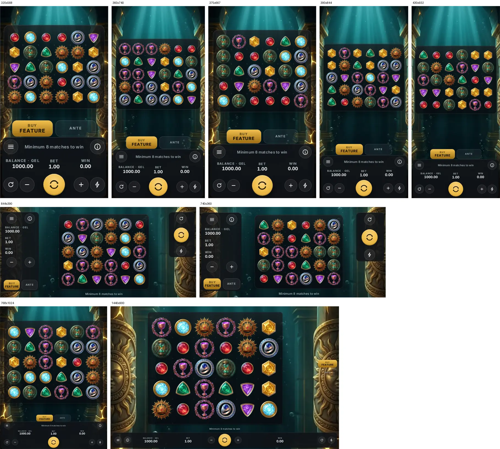
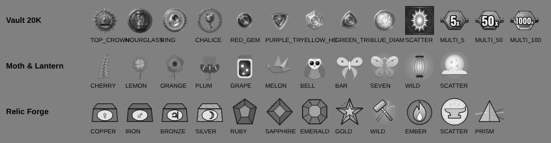

# Lumina overhaul

One shared player interface for all three Lumina games, the market rules on the client, no
celebration of a return at or below the stake, a new Vault 20K multiplier, and motion that
explains every result. Research: `reports/Slot provider UI and motion.md`. Audit:
[`00-audit.md`](00-audit.md). Math, RTP, pays, max win and every id are untouched (the
seeded RTP parity run in CI is the proof).

## What changed

| Area | Before | After |
|---|---|---|
| Interface | Three different decks, three message lines, three settings dialogs | One **Lumina Shell**: the same controls in the same places in every game (`lumina-parity` checks it at 390x844, 844x390, 1440x900) |
| Markets | Platform enforced pacing, reality check and buy; the clients hid autoplay / turbo only in Vault | Every game hides autoplay, speed and buy in place, honours slam stop bans, caps the bet ladder and the buy under the stake cap, paces from the answer |
| Sub-stake wins | Win sounds, bursts and a gold "WIN" for any win above zero | Under `celebrate_threshold: "gt_stake"`: a plain "Credit" line, no win effects; the board still shows what paid (`no-celebrate`) |
| Vault multiplier | A lightning bolt from the top and a winged sun disc | The vault's laser cuts a machined hex plate free, sideways from the frame rail ([storyboards](vault-multiplier.md)) |
| Big-win ladder | Vault 10/25/50x, Moth & Lantern 10/25/50x, Relic Forge 10/50/200x | One ladder in every game: 10 / 25 / 50 / 100x, each game naming its tiers (Vault: VAULT CRACKED, LASER BREACH, MOTHERLODE, CROWN JEWELS) |
| Timings | Constants in three files, three turbo models | One motion table (`client/shell/motion.js`) |
| Idle | Vault redrew at about 20 fps at rest | No frames at rest in any game |
| Explanations | Few | Vault: neutral credit, sum badge (5x + 10x), laser reveal. Moth & Lantern: lines with amounts, the x3 stamp, the wild fold, line numbers. Relic Forge: the cluster outline and its pay, embers flying into the crucible, anticipation, relic plates engraving in |



## The shell

`client/shell/shell.js` (served at `/play/shell/`, copied into the demo by `tools/build-demo.mjs`).

```js
const shell = LuminaShell.mount({
  game: "classic",                  // theme key (.lsh[data-game])
  stage: boardElement,              // moved into the frame; the shell never touches inside it
  features: { buy, ante, autoplay, turbo, stop },
  fmt, currency, haptics, build, historyUrl,
  stakeMultiplier: () => 1.25,      // ante raises the cycle stake (bet sheet vs the cap)
  tickerFlash,                      // a game that drives the message line takes the notices
  on: { spin, betStep, betIndex, autoplay(n, { lossX, winX, feature }), autoplayStop,
        info: () => html, buy, ante, pref }
});
```

The returned object: `ticker` (`idle`, `spin`, `win(text, celebrate)`, `neutral`, `say`,
`flash`), `setPhase` (ready / flight / result / tumble / feature / autoplay / wait / broke /
blocked), `setSpinMode` (spin / stop / skip / pick / wait), `setBets`, `setBetLocked`,
`featureHud({ left, win, label, winLabel })`, `waiting`, `notice`, `ask` (blocking),
`applyMarket(rules)`, `celebrates(roundWin, stake)`, `slamAllowed`, `turboAllowed`,
`autoplayCap`, `setBalance` / `trackBalance` (session strip), `setBet`, `setWin`,
`setAnte`, `setAutoplay`, `setSpeed`, `openMenu`, `openInfo`, `closeSheets`.

Element ids are the same in every game (`spinBtn`, `betDownBtn`, `betUpBtn`, `autoplayBtn`,
`turboBtn`, `psMenuBtn`, `psInfoBtn`, `psTicker`, `footerBalance`, `footerBet`, `footerWin`,
`betSheetBtn`, `buyFreeBtn`, `anteToggle`). Every popup is a VxNotify sheet. A game themes the
shell only through `--lsh-*` tokens. Vault 20K mounts it in `client/vault-shell.js`.

## The motion module

`client/shell/motion.js` (`LuminaMotion`): every event of the motion grammar with `normal`,
`quick`, `turbo`, `reduced`, a `skip` rule and an empty `measured` column. The values are the
report's recommendations (REC), not measured provider timings: competitor demos were not
reachable from here (see the audit), so the `measured` column waits for a measurement from an
unblocked machine. `ms(event, speed)`, `tierFor(x)`, `game(code)` for each game's physics.

## Market switches

Set per operator on the platform (`PUT /admin/v1/operators/:id/regulatory`, presets in
`platform/src/modules/regulatory/regulatory.ts`); the client reads the session's
`regulatory` block, and a field the RGS leaves out falls back on the jurisdiction
(`LuminaShell.MARKET_FALLBACK`). Illustrative, not legal advice: confirm with the test lab
and counsel before a launch.

| Market | Pace | Autoplay | Speed / slam | No-celebrate | Stake cap | Session strip | Source |
|---|---|---|---|---|---|---|---|
| UKGC | 2.5 s | off | off | yes | £5 (£2 under 25) | net + time | RTS 14D/14E/14F, 8C: VERIFIED |
| ON | 2.5 s | off | off | yes | none | net + time | AGCO 2.15-2.22: VERIFIED |
| DE | 5 s | off | off | yes | €1, buy off | panic button (not built yet) | GlüStV §22a, §6i: VERIFIED; a 2026 cap change UNCONFIRMED, not encoded |
| SE | 3 s | on (100) | off | yes | none | balance | SIFS 2022:3: VERIFIED (pace, no queued presses); autoplay ban UNCONFIRMED |
| ES | 3 s | on (100) | off | yes | none | session | UNCONFIRMED (law-firm summary) |
| NL | none | off | off | yes | none | none | UNCONFIRMED (press statements) |
| NJ | none | off | on | no | none | clock + elapsed | N.J.A.C. 13:69O: VERIFIED |
| MGA | none | on (100) | on | yes (Lumina's own policy) | none | none | illustrative |

The client caps stakes only on the client: the RGS does not enforce `max_stake` (agreed:
fields only, no server enforcement in this run).

## Probes

| Probe | What it proves | Where |
|---|---|---|
| `npm run test:motion` | every renderer reads its timings from the motion table | test:client |
| `npm run test:shell` | the shell at 9 sizes: nothing off screen, no overlap, hit areas ≥44 px | test:client |
| `tools/probes/lumina-parity.mjs` | controls identical in all three games (place, size, focus order, name, state); no animation frames for 3 s at rest | test:lumina (CI job lumina-checks) |
| `tools/probes/lumina-audit.mjs` | every game at the 9 sizes: in view, no overlap, hit areas ≥44 px (main) / ≥40 px, labels ≥12 px, text contrast ≥4.5:1 from the real pixels | test:lumina |
| `tools/probes/market-switches.mjs` | UK / DE / default: autoplay, speed, buy and slam as the market says; pacing | test:lumina |
| `tools/probes/no-celebrate.mjs` | under UK, no round at or below the stake gets a win sound, gold line or overlay; above it still celebrates | test:lumina |
| `tools/probes/symbol-sheet.mjs` | every symbol of every game at 48 px in grayscale (sheet below) | test:lumina |
| `tools/probes/paytable-probe.js` | Vault's displayed pays equal paid pays, all profiles and bets | manual gate |



Review of the sheet: Moth & Lantern separates well by shape. In Vault 20K the crown,
hourglass, ring and chalice share a round medallion and the purple and green triangles share a
silhouette; in Relic Forge the four metal ingots share a shape and differ only by their
engraved sign. Both are art changes, listed as open below.

## Numbers

Measured on the demo build served with gzip (as on real hosting), headless Chrome at 390x844.
Before = `main` before this run's Vault and Relic Forge PRs (Moth & Lantern and Relic Forge were
already on the shell); after = the end of the run. Time to playable on a throttled phone profile
(150 ms RTT, 1.6 Mbps down, 4x CPU); frame times and idle frames without throttling. Budgets
from the report, Part 5.

| | Vault 20K before → after | Moth & Lantern before → after | Relic Forge before → after | Budget |
|---|---|---|---|---|
| Transferred before the game is ready | 0.38 → 0.39 MB | 0.10 → 0.10 MB | 0.37 → 0.37 MB | ≤ 4 MB |
| Game code, gzipped | 166 → 176 KB | 57 → 58 KB | 68 → 71 KB | ≤ 300 KB |
| Time to playable (throttled) | 2.9 → 2.9 s | 1.2 → 1.1 s | 2.5 → 2.6 s | ≤ 6 s |
| p95 frame during a round | 16.8 → 16.7 ms | 16.7 → 16.8 ms | 16.7 → 16.8 ms | ≤ 16.7 ms (mid tier) |
| Frames drawn in 3 s at rest | 181 → **0** | 0 → 0 | 0 → 0 | 0 |

The shell itself is 21.6 KB gzipped (shell.js 10.9, shell.css 5.4, motion.js 4.2, Vault's
mount 1.1), inside its 40 KB budget. Not measured in this run: the 30-minute heap soak and the
low-tier frame budget on a real low-end phone (`npm run bench:client -- --mode soak` and a
device test).

## PRs

#112 research and audit · #114 / #115 the shell · #116 Moth & Lantern on the shell · #117 jurisdiction profile fields · #118 Relic Forge on the shell · #119 Relic Forge animations · #120 Vault market switches and no-celebrate · #121 ambiance retired · #122 Vault multiplier · #123 Vault on the shell, idle zero · #124 old deck CSS removed · #125 probes in CI, session strip, lobby, these docs.

## Open

- **Art:** the silhouette findings above (Vault medallions and triangles, Relic Forge ingots).
- **Germany:** the panic button (`session_hud: "panic"`) and the payout-per-€1 display at the
  stake (`rtp_display: "stake_area"`) are profile fields the clients do not show yet.
- **Measured timings:** the motion table holds the report's recommendations; the `measured`
  column stays empty until competitor demos can be recorded.
- **IP review:** the new Vault multiplier key frames ([storyboards](vault-multiplier.md),
  `img/vault-laser-reveal.webp`, `img/vault-hex-plates.webp`) wait for your review.
- **Background art:** Vault 20K's temple backdrop has sun-face columns; worth a look in the
  same IP review.
