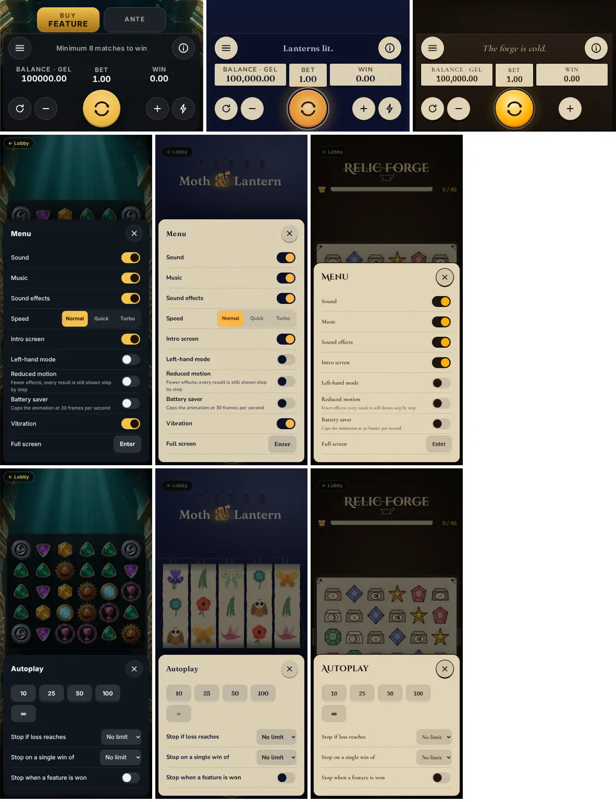
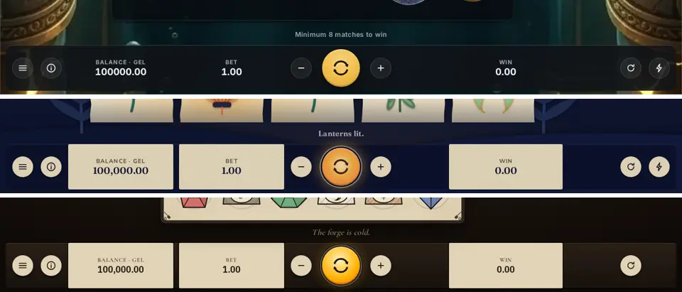
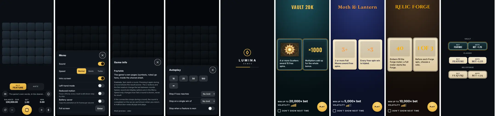
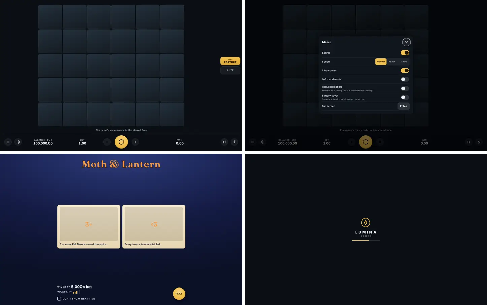

# Lumina layers: what is shared, what is themed

Every Lumina game has the **same system interface, pixel for pixel**. Only the game itself and a short list of themed slots look different. A player who knows one Lumina game knows them all. This file is the contract; `tools/probes/chrome-identity.mjs` and `tools/probes/theme-lint.mjs` enforce it (step 4).

## Today (audit, main at #128, demo build, 390x844 and 1440x900)

Positions and sizes already match in all three games (`lumina-parity`). Looks do not. An audit of the computed styles of 17 chrome elements: **180 differences**, in every element.

| Element | Vault 20K | Moth & Lantern | Relic Forge |
|---|---|---|---|
| UI face | Inter ("Vault UI") | Nunito ("ML UI") | Cormorant Garamond ("RF Text") |
| Number face | system-ui (not even Vault's own face) | Fraunces ("ML Display") | IBM Plex Sans Condensed |
| Deck | dark glass | dark navy | dark brown |
| Readouts | text on the deck | cream paper boxes, 3 px corners | parchment boxes, 2 px corners, 1 px black ring |
| Buttons (menu, info, ±, autoplay, speed) | translucent circles | cream paper circles with a drop | parchment circles, black ring |
| Spin | gold disc | orange paper disc, navy ring | gold disc, black ring |
| Message line | 13 px sans, grey | 15.7 px serif | 17.3 px italic serif |
| Sheets (menu, info, autoplay, bet) | dark | cream paper, serif | parchment, Cinzel titles, serif rows |
| Buy chip | gold, 14 px corners | orange, 10 px | amber, 4 px |

Cause: each game sets about 20 `--lsh-*` tokens (fonts, deck, spin face, readout surface, sheet, radius); Relic Forge adds 23 direct `.lsh*` rules (its sheet skin); Vault sets 7 in `styles.css`. Also: the menu's "Intro screen" switch (`prefs.intro`) has no screen behind it, and the demo's Lobby link floats over Vault's menu button in landscape.

## The three layers

### Layer 1: system chrome (identical; no game may change it)

| Element | Notes |
|---|---|
| Deck and strip surface | one graphite glass, one hairline |
| Balance / Bet / Win readouts | label 12 px uppercase, value 700 tabular; Win's celebrated colour is the system gold |
| Spin, bet − / +, autoplay, speed, menu, info | one icon set, one face, one ring; Spin is the Lumina gold disc |
| Message line (`#psTicker`) | one face, size and colour. The game chooses the **words** ("The forge is cold."), never the look |
| Session strip, DE panic button, DE RTP at the stake | as built in #128 |
| Every sheet | menu, settings, autoplay, bet ladder, info / paytable frame, notice, ask, reality check, insufficient funds, connection lost, panic confirmation |
| Provider loader | Lumina Games mark drawn in code, a gold progress bar, the same in every game |
| Lobby / "Back to games", full screen | fixed system places in the strip's host zone (no floating link) |
| Focus rings, the "+N" fly, the callout bubble | system |
| Intro splash: the facts row and its controls | "Win up to N× bet", volatility, "Don't show next time", Play: same face and place in every game |

Values: one face for words and numbers (Inter, `client/assets/fonts/inter-sub-wght-400-900.woff2`, SIL OFL, already shipped), one icon set, one colour set (graphite `#0b0f14` / deck `rgba(10,14,20,.86)`, ink `#eef1f4`, labels `#9aa7ad`, Lumina gold `#f2c14e`), one spacing scale, one radius (14 px). They live in `shell.css` only.

### Layer 2: themed slots (shell owns place, size, structure, behaviour; the game supplies a skin)

| Slot | Structure (fixed) | Skin (game) |
|---|---|---|
| Feature rail cards: Buy, Ante, one spare | fixed geometry per layout; label, price in × bet and currency, states from the shell; an absent feature leaves its cell empty | surface, border, ink, title face |
| Feature panel (intro / retrigger / outro, `shell.panel`) | kicker, title, one rule line, stats, total, continue | frame, title face, accent |
| Big win / max win (`shell.bigWin`, new) | shared ladder, count-up, skip, 400-700 ms hold; replaces Vault's `big-win.js` chrome, Moth & Lantern's `#celebration`, Relic Forge's `#banner` tiers | tier names, frame, title face, the game's particles behind it |
| Intro splash (new; `prefs.intro`) | logo zone, one or two feature cards (art + one line), the Layer 1 facts row | scene, card surface, art, title face |
| Logo zone | one box per layout | the game's logo |
| Paytable pages | inside the Layer 1 info sheet | symbol art, rules text |

The skin is one object passed to `LuminaShell.mount({ skin })`: only `--skin-*` custom properties (`--skin-slot-bg`, `--skin-slot-border`, `--skin-slot-ink`, `--skin-title-font`, `--skin-accent`, `--skin-scene`, `--skin-frame`) and asset URLs. The shell reads them only inside Layer 2 slots. `--lsh-*` become private to `shell.css`.

Facts on the splash come from data, never literals: max win from rules (`max_win_cap_multiplier` / `max_win_x`); volatility from the game's manifest `games/<code>/game.json` (a new presentation field, `volatility: 1..5`; Vault's rules already say "high"), never from the math.

### Layer 3: the game (free)

Board, symbols, background, mascot, in-board HUDs (Vault's multiplier badge and doors, Moth & Lantern's lanterns and pay glass, Relic Forge's crucible meter and relic tray), effects, sounds, the message line's words.

## Proposal (for review)

The Lumina chrome, and the Layer 2 slots in three skins (`client/shell/preview.html`; `?view=loader|splash|rail`, `?sheet=menu|info|auto|bet`, `?skin=vault|classic|relicforge`):

## Steps

1. Lock the system chrome: values into `shell.css`, delete every game-side `--lsh-*` override and `.lsh*` rule, one face, sheets the same everywhere, Lobby / full screen into the strip.
2. Themed slots on the skin API: rail cards, shared panel, shared big win, logo zone; each game's current look ported into its skin.
3. Provider loader and intro splash.
4. `chrome-identity` (computed styles + pixel diff of deck, strip and every sheet across the three games at the 9 sizes, stage flattened) and `theme-lint` (no `--lsh-*` or `.lsh` styling outside the slot hooks in game files) in `test:lumina`; docs.
