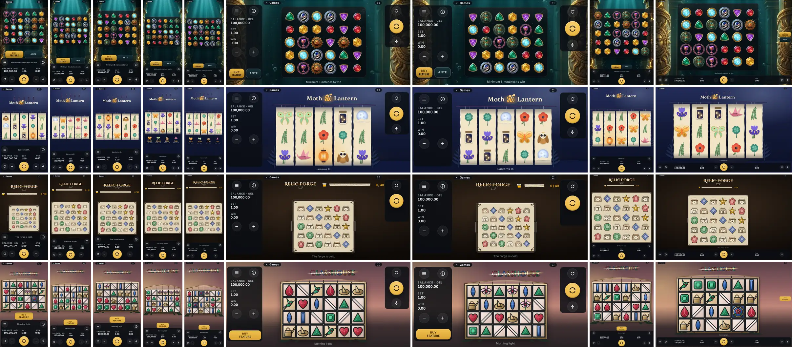

# Lumina layers: what is shared, what is themed

Every Lumina game has the **same system interface, pixel for pixel**. Only the game itself and a short list of themed slots look different. A player who knows one Lumina game knows them all. This file is the contract; `tools/probes/chrome-identity.mjs` and `tools/probes/theme-lint.mjs` enforce it (step 4).

## Today (audit, main at #128, demo build, 390x844 and 1440x900)

Positions and sizes already matched in all three games of the time (`lumina-parity`). Looks do not. An audit of the computed styles of 17 chrome elements: **180 differences**, in every element.

| Element | Vault 20K | Moth & Lantern | Relic Forge |
|---|---|---|---|
| UI face | Inter ("Vault UI") | Nunito ("ML UI") | Cormorant Garamond ("RF Text") |
| Number face | system-ui (not even Vault's own face) | Fraunces ("ML Display") | IBM Plex Sans Condensed |
| Deck | dark glass | dark navy | dark brown |
| Readouts | text on the deck | cream paper boxes, 3 px corners | parchment boxes, 2 px corners, 1 px black ring |
| Buttons (menu, info, ±, autoplay, speed) | translucent circles | cream paper circles with a drop | parchment circles, black ring |
| Spin | gold disc | orange paper disc, navy ring | gold disc, black ring |
| Message line | 13 px sans, grey | 15.7 px serif | 17.3 px italic serif |
| Sheets (menu, info, autoplay, bet) | dark | cream paper, serif | parchment, Cinzel titles, serif rows |
| Buy chip | gold, 14 px corners | orange, 10 px | amber, 4 px |

Cause: each game sets about 20 `--lsh-*` tokens (fonts, deck, spin face, readout surface, sheet, radius); Relic Forge adds 23 direct `.lsh*` rules (its sheet skin); Vault sets 7 in `styles.css`. Also: the menu's "Intro screen" switch (`prefs.intro`) has no screen behind it, and the demo's Lobby link floats over Vault's menu button in landscape.

## The three layers

### Layer 1: system chrome (identical; no game may change it)

| Element | Notes |
|---|---|
| Deck and strip surface | one graphite glass, one hairline |
| Balance / Bet / Win readouts | label 12 px uppercase, value 700 tabular; Win's celebrated colour is the system gold |
| Spin, bet − / +, autoplay, speed, menu, info | one icon set, one face, one ring; Spin is the Lumina gold disc |
| Message line (`#psTicker`) | one face, size and colour. The game chooses the **words** ("The forge is cold."), never the look |
| Session strip, DE panic button, DE RTP at the stake | as built in #128 |
| Every sheet | menu, settings, autoplay, bet ladder, info / paytable frame, notice, ask, reality check, insufficient funds, connection lost, panic confirmation |
| Provider loader | Lumina Games mark drawn in code, a gold progress bar, the same in every game |
| Lobby / "Back to games", full screen | fixed system places in the strip's host zone (no floating link) |
| Focus rings, the "+N" fly, the callout bubble | system |
| Intro splash: the facts row and its controls | "Win up to N× bet", volatility, "Don't show next time", Play: same face and place in every game |

Values: one face for words and numbers (Inter, `client/assets/fonts/inter-sub-wght-400-900.woff2`, SIL OFL, already shipped), one icon set, one colour set (graphite `#0b0f14` / deck `rgba(10,14,20,.86)`, ink `#eef1f4`, labels `#9aa7ad`, Lumina gold `#f2c14e`), one spacing scale, one radius (14 px). They live in `shell.css` only.

### Layer 2: themed slots (shell owns place, size, structure, behaviour; the game supplies a skin)

| Slot | Structure (fixed) | Skin (game) |
|---|---|---|
| Feature rail cards: Buy, Ante, one spare | fixed geometry per layout; label, price in × bet and currency, states from the shell; an absent feature leaves its cell empty | surface, border, ink, title face |
| Feature panel (intro / retrigger / outro, `shell.panel`) | kicker, title, one rule line, stats, total, continue | frame, title face, accent |
| Big win / max win (`shell.bigWin`, new) | shared ladder, count-up, skip, 400-700 ms hold; replaces Vault's `big-win.js` chrome, Moth & Lantern's `#celebration`, Relic Forge's `#banner` tiers | tier names, frame, title face, the game's particles behind it |
| Intro splash (new; `prefs.intro`) | over the stage only (the deck stays usable; Spin closes it and spins; a round starting closes it): the game's name, one or two feature cards (art + one line), the Layer 1 facts row and Play | scene, card surface, art, title face |
| Paytable pages | inside the Layer 1 info sheet | symbol art, rules text |

The logo stays the game's (Layer 3). The proposal had a fixed logo zone; the reference games themselves put their logo in different places (top right, top centre), Vault 20K has none, and moving the other two logos would move their boards. The splash carries each game's name in its title face instead.

The skin is one object passed to `LuminaShell.mount({ skin, particles })`: only `--skin-*` custom properties and asset URLs. As built: type and accent (`--skin-title-font` / `-case` / `-weight`, `--skin-amount-font` for the big-win figures when the title face is too thin, `--skin-accent`), rail cards (`--skin-slot-bg` / `-ink` / `-edge`, `--skin-buy-*`), the panel (`--skin-panel-bg` / `-ink` / `-muted` / `-title` / `-total` / `-frame` / `-radius`), the big win (`--skin-tier-big` … `-max`, `--skin-win-hi` / `--skin-win` / `--skin-win-deep`, `--skin-bigwin-scrim` / `-core`, `--skin-laser*`), the splash (`--skin-scene`); `particles` recolours the big win's coins and sparks. The shell reads them only inside Layer 2 slots. `--lsh-*` become private to `shell.css`.

Facts on the splash come from data, never literals: max win from rules (`max_win_cap_multiplier` / `max_win_x`), feature counts and multipliers from rules; volatility (Low / Medium / High) from where it is declared: Vault 20K's rules (`volatility: "high"`), Moth & Lantern's `math-spec.md` ("medium"), Relic Forge's GDD ("High"), Glasshouse's `DESIGN.md` ("medium-high", shown as Medium-high with a half third bar).

### Layer 3: the game (free)

Board, symbols, background, mascot, in-board HUDs (Vault's multiplier badge and doors, Moth & Lantern's lanterns and pay glass, Relic Forge's crucible meter and relic tray, Glasshouse's brass house and beam), effects, sounds, the message line's words.

## Proposal (for review)

The Lumina chrome, and the Layer 2 slots in three skins (`client/shell/preview.html`; `?view=loader|splash|rail`, `?sheet=menu|info|auto|bet`, `?skin=vault|classic|relicforge`):

## Built (every game, 9 sizes; rows: Vault 20K, Moth & Lantern, Relic Forge, Glasshouse)

Glasshouse (game #4) arrived while the contract was being built and was brought into it the same way: its brass `--lsh-*` theme and `.lsh*` rules became a skin, its own in-board big win became the shared one ("Sunlit" … "Zenith", Full Bloom as the max-win tier), and it got the loader and the splash.

[Deck](img/chrome-deck-9.webp) · [intro splash](img/chrome-splash-9.webp) · [menu](img/chrome-menu-9.webp) · [info](img/chrome-info-9.webp) · [autoplay](img/chrome-autoplay-9.webp) · [feature panel](img/chrome-panel-9.webp) · [big win](img/chrome-bigwin-9.webp)

## How it is enforced

- `tools/probes/theme-lint.mjs`: no game file sets a `--lsh-*` property or styles a `.lsh*` element (a game's own elements inside shell containers, the `html.lsh-reduced` prefix and `:not(...)` exclusions are allowed).
- `tools/probes/chrome-identity.mjs`: at the 9 sizes, the computed styles of every chrome element are identical in every game, and with the game layers hidden the frame renders to the same pixels (0 differing pixels at seven sizes; 3 px of the Spin ring's edge anti-alias differently in Vault 20K at 375x667 and 430x932, so up to 8 px are allowed; one game tab at a time); the menu, info, autoplay and bet sheets share their styles; the loader is the same markup.
- Both run in `test:lumina` (CI job `lumina-checks`).

## Steps

1. Lock the system chrome: values into `shell.css`, delete every game-side `--lsh-*` override and `.lsh*` rule, one face, sheets the same everywhere, Lobby / full screen into the strip.
2. Themed slots on the skin API: rail cards, shared panel, shared big win, logo zone; each game's current look ported into its skin.
3. Provider loader and intro splash.
4. `chrome-identity` (computed styles + pixel diff of deck, strip and every sheet across the three games at the 9 sizes, stage flattened) and `theme-lint` (no `--lsh-*` or `.lsh` styling outside the slot hooks in game files) in `test:lumina`; docs.
